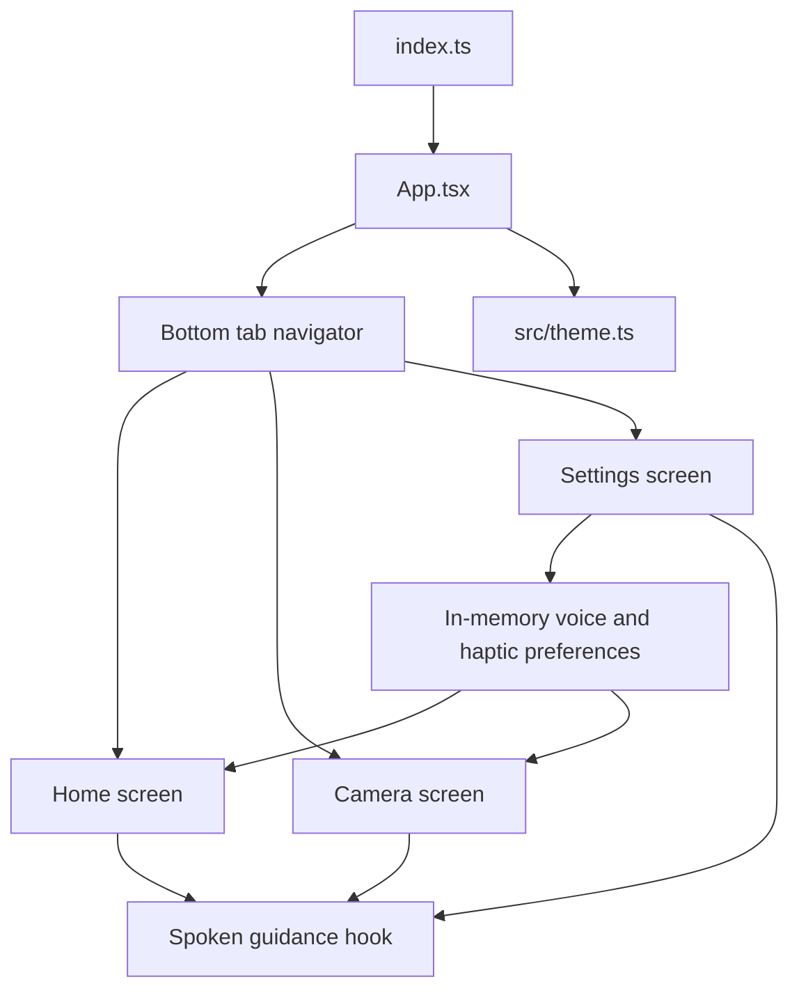

# Architecture and feature behavior

## App composition

`index.ts` registers `App.tsx` with Expo. `App.tsx` creates the bottom-tab navigation container and owns voice/haptic preference state. The navigation theme and each screen share colors and the feedback context from `src/theme.ts`.

## Screens

| Screen | Current behavior | Limitations |
| --- | --- | --- |
| Home | Explains the experience and opens the camera tab; uses optional speech and haptics. | The copy explicitly says currency recognition is still being prepared. |
| Camera | Requests permission after a user action, then shows an `expo-camera` live preview. | The action does not capture a photo or run a model. It announces that recognition is unavailable. |
| Preferences | Toggles spoken navigation and touch feedback for the current app session. | Values reset to enabled after a restart; no persistent storage is used. |

## State and feedback

`App.tsx` stores the `voice` and `haptics` booleans in React state and exposes them through `FeedbackContext`. `SettingsScreen` updates the same state through props. The `useSpokenGuidance` hook announces the screen name and a short orientation prompt whenever Home, Detect, or Settings gains focus. Each screen offers a repeat-guidance button while voice navigation is enabled. `HomeScreen` and `CameraScreen` also use the settings before invoking `expo-haptics` or speaking result messages. Speech is stopped when a screen loses focus. No microphone input or speech recognition is used, and no settings are written to disk.

The home screen uses React Native's `Animated` API for a short feature-card entrance and a restrained press tilt/scale on the main action. The camera-ready indicator pulses with a repeating opacity/scale animation. That indicator means the camera preview is available; it does not mean a banknote is being recognized.

## Camera permission and image handling

`app.json` configures the Expo Camera plugin with a user-facing permission explanation and disables Android audio recording. `CameraScreen` calls `useCameraPermissions` and calls `requestPermission` only from the permission button. With permission granted, `CameraView` displays a live preview. The current action handler returns an unavailable message without taking a picture. There is no image upload, image persistence, model inference, or currency result history. The History tab was removed until useful saved results exist.

## Dependency and build setup

Expo's camera, speech, and haptics modules and the native navigation support modules are aligned with SDK 58. The unused `expo-sqlite` dependency was removed. `package-lock.json` is committed to keep npm installs reproducible. Scoped dependency overrides pin the affected Expo tooling dependency requests to patched `glob` and `minimatch` releases; see [SECURITY.md](../SECURITY.md) and the dependency security note in the README. The 2026-11-04 Expo check suggested newer patch releases for Expo itself and safe-area context; a registry timeout prevented installing them, so the committed lockfile remains on the last successfully exported versions.

## Adding recognition or a future history feature

Before implementing either feature, decide and document:

1. Which model and currencies are supported, and how uncertainty is communicated.
2. Whether inference runs locally or sends images to a service.
3. Whether images or results are stored, their retention period, and the deletion flow.
4. How confidence thresholds and unsupported notes are handled without presenting guesses as fact.
5. The accessibility behavior for progress, success, uncertainty, and errors.
